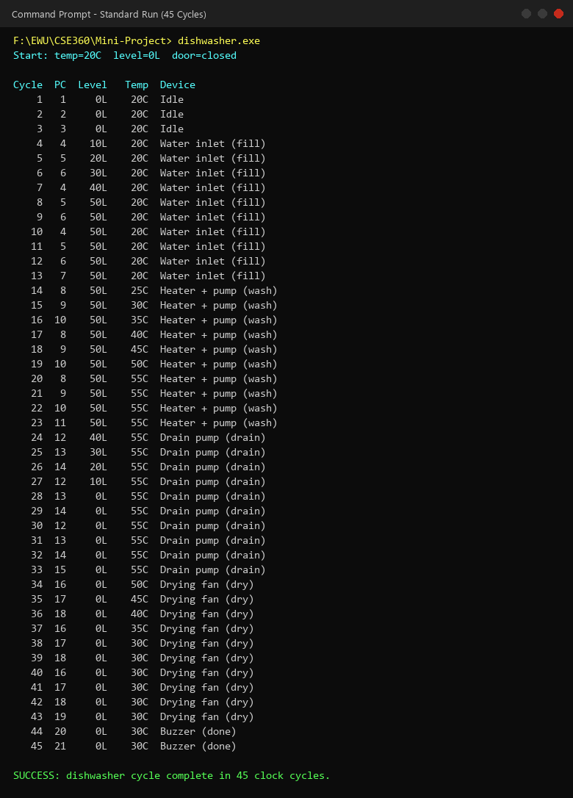
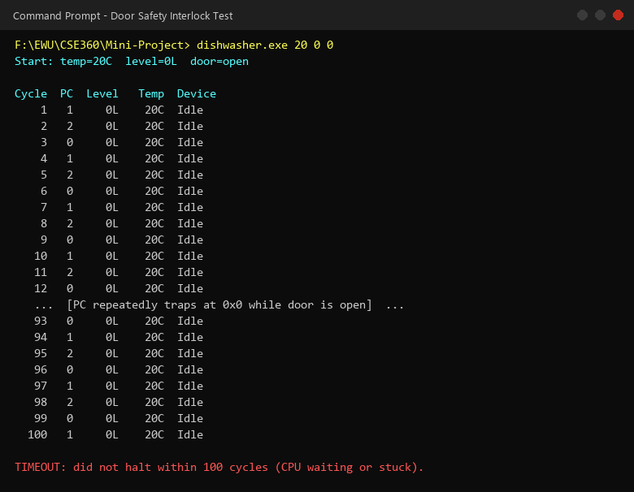
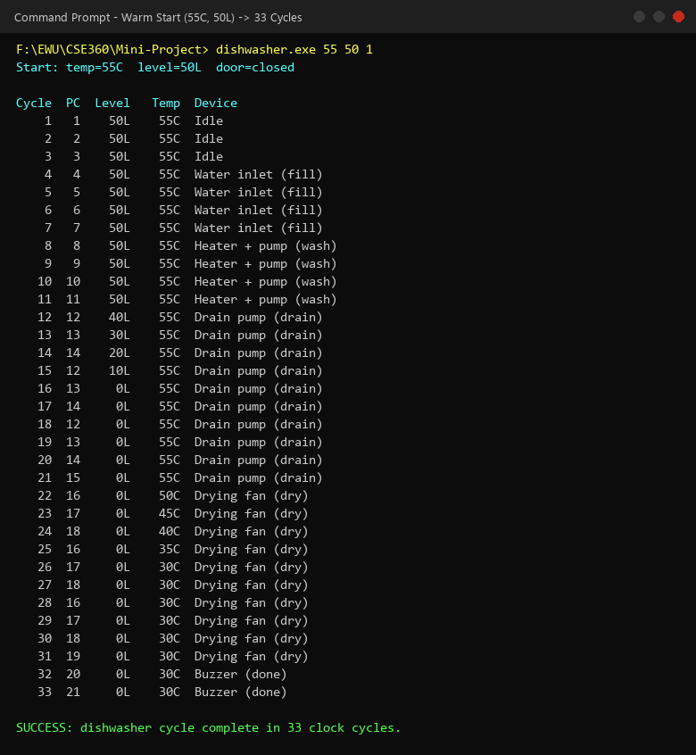
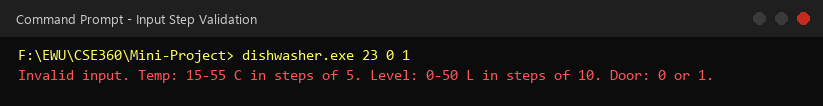

# Minimal Dishwasher CPU Architecture & Simulator
### CSE360: Computer Architecture Mini-Project | East West University (EWU)

---

## 📌 Project Overview
**Course:** CSE360 – Computer Architecture  
**Department:** Department of Computer Science & Engineering, East West University  
**Topic:** *Suggest and design a minimal CPU architecture, including ISA, datapath, and control unit, for automating dishwasher control functions with sensor inputs, and verify it with a simulator.*

This project implements a custom **minimal 8-bit Application-Specific Instruction-set Processor (ASIP)** designed specifically to automate a domestic dishwasher. Instead of deploying an oversized, general-purpose commercial microprocessor with hundreds of complex instructions, our CPU implements only **5 targeted instructions** operating on a lean datapath.

The processor controls a complete wash cycle (door safety check, water fill, wash & heating, drainage, convection drying, and audible completion buzzer) using sensor feedback and runs a verified cycle-accurate simulator in pure C.

---

## ⚙️ Architecture Specification

### 1. Instruction Set Architecture (ISA)
Each instruction is packed into a compact **9-bit word** (3-bit opcode + 6-bit operand) represented in C as a 2-byte bit-field struct (`uint16_t`):

| Opcode (Binary) | Mnemonic | Operand (6 bits) | RTL Micro-Operation | Description |
|:---:|:---|:---|:---|:---|
| `000` (`0`) | `READ` | Sensor Port (`0–2`) | `ACC` $\leftarrow$ `Sensors[operand]` | Reads sensor reading into Accumulator register |
| `001` (`1`) | `SET`  | Actuator Port (`0–4`) | `DEVICE` $\leftarrow$ `operand` | Activates target actuator output |
| `010` (`2`) | `CMP`  | Immediate Value (`0–63`) | `ZF` $\leftarrow$ `(ACC == operand)` | Compares `ACC` with value and sets Zero Flag (`ZF`) |
| `011` (`3`) | `JNE`  | Target Address (`0–63`) | `if (!ZF) PC` $\leftarrow$ `operand` | Jumps to target PC address if `ZF == 0` |
| `100` (`4`) | `HALT` | `0` (Unused) | `halted` $\leftarrow$ `1` | Stops processor execution clock |

### 2. Datapath & Registers
* **`pc` (Program Counter):** 8-bit signed register holding the address of the next instruction to fetch.
* **`acc` (Accumulator / Data Register):** 8-bit register storing sensor values and comparison operands.
* **`zf` (Zero Flag):** 1-bit condition flag set to `1` when `acc == operand`, used by `JNE`.
* **`halted` (Halt Flag):** 1-bit flag set to `1` by `HALT` to stop the processor clock.
* **`device` (Actuator Register):** Stores the ID of the currently energized physical component (or `-1` when idle).

### 3. I/O Port Map
* **Sensors (Inputs):**
  * Port `0` (`DOOR`): Safety switch (`1` = closed, `0` = open)
  * Port `1` (`LEVEL`): Tub water volume in Liters ($0$ to $50\text{ L}$)
  * Port `2` (`TEMP`): Water temperature in Celsius ($15^\circ\text{C}$ to $55^\circ\text{C}$, default start $20^\circ\text{C}$)
* **Actuators (Outputs):**
  * Port `0` (`INLET`): Water inlet solenoid valve ($+10\text{ L/cycle}$)
  * Port `1` (`HEATER`): 1200W heating coil & spray wash circulation pump ($+5^\circ\text{C/cycle}$)
  * Port `2` (`DRAIN`): Centrifugal water evacuation drain pump ($-10\text{ L/cycle}$)
  * Port `3` (`FAN`): Heated air convection drying blower fan ($-5^\circ\text{C/cycle}$)
  * Port `4` (`BUZZER`): Piezoelectric audio beeper signaling cycle complete

---

## 🔁 Automated Wash Cycle Flow

The program stored in ROM executes a 6-stage automation sequence:
```
  [Stage 0: Door Safety]   --> Read DOOR; loop if open.
            │
            ▼
  [Stage 1: Fill Tub]      --> Turn ON INLET valve until Level == 50 Liters.
            │
            ▼
  [Stage 2: Wash & Heat]   --> Turn ON HEATER & spray pump until Temp == 55 °C.
            │
            ▼
  [Stage 3: Drain Water]   --> Turn ON DRAIN pump until Level == 0 Liters.
            │
            ▼
  [Stage 4: Heated Drying] --> Turn ON DRYING FAN until Temp cools to 30 °C.
            │
            ▼
  [Stage 5: Complete]      --> Turn ON BUZZER and execute HALT.
```

---

## 💻 Compilation & Execution

### Build
Compile the single-file simulator using any standard C99 compiler:
```bash
gcc -std=c99 -Wall dishwasher.c -o dishwasher.exe
```

### Run Options (Inputs)
The simulator accepts command-line arguments to simulate different environmental sensor conditions:
```bash
# 1. Standard default wash (start at 20°C, 0L, door closed)
dishwasher.exe

# 2. Custom starting parameters: [start_temp] [start_level] [door_closed]
# Example: Door open test (door = 0)
dishwasher.exe 20 0 0

# 3. Fast warm-start test (start at 55°C, 50L, door closed)
dishwasher.exe 55 50 1
```

> **Note on Input Validation:** Valid temperature range is $15\text{--}55^\circ\text{C}$ in steps of $5$. Valid water level is $0\text{--}50\text{ L}$ in steps of $10$. Door must be `1` (closed) or `0` (open).

---

## 📊 Outputs & Test Execution

### 1. Standard Wash Cycle (Default)
Executes all wash stages and finishes successfully in **45 clock cycles**:



```text
Start: temp=20C  level=0L  door=closed

Cycle  PC  Level   Temp  Device
    1   1     0L    20C  Idle
    2   2     0L    20C  Idle
    3   3     0L    20C  Idle
    4   4    10L    20C  Water inlet (fill)
    ...
   13   7    50L    20C  Water inlet (fill)
   14   8    50L    25C  Heater + pump (wash)
    ...
   23  11    50L    55C  Heater + pump (wash)
   24  12    40L    55C  Drain pump (drain)
    ...
   33  15     0L    55C  Drain pump (drain)
   34  16     0L    50C  Drying fan (dry)
    ...
   43  19     0L    30C  Drying fan (dry)
   44  20     0L    30C  Buzzer (done)
   45  21     0L    30C  Buzzer (done)

SUCCESS: dishwasher cycle complete in 45 clock cycles.
```

---

### 2. Safety Interlock Test (Door Open at Start)
When the door is opened (`door = 0`), the CPU detects unsafe conditions at PC 0–2 and repeatedly loops across PC 0–2 (printing PC `1, 2, 0`). No water valves, heaters, or pumps are allowed to activate:



```text
Start: temp=20C  level=0L  door=open

Cycle  PC  Level   Temp  Device
    1   1     0L    20C  Idle
    2   2     0L    20C  Idle
    3   0     0L    20C  Idle
   ...  [PC repeatedly traps at 0x0 while door is open]  ...
   99   0     0L    20C  Idle
  100   1     0L    20C  Idle

TIMEOUT: did not halt within 100 cycles (CPU waiting or stuck).
```

---

### 3. Fast Warm-Start Test (Pre-filled & Pre-heated)
When water is already at 50L and 55°C, the CPU immediately skips filling and heating loops, jumping directly to draining and drying:



```text
Start: temp=55C  level=50L  door=closed
...
SUCCESS: dishwasher cycle complete in 33 clock cycles.
```

---

### 4. Robust Input Step Validation
If invalid physical parameters that cannot converge with the step sizes are provided, the simulator immediately catches and rejects them safely:



```text
F:\EWU\CSE360\Mini-Project> dishwasher.exe 23 0 1
Invalid input. Temp: 15-55 C in steps of 5. Level: 0-50 L in steps of 10. Door: 0 or 1.
```

---

## 📁 Repository File Structure

```
├── dishwasher.c       # Complete C source code (ISA, Datapath, Control Unit, Plant simulator)
├── dishwasher.exe     # Pre-compiled executable binary (Windows x64)
├── CSE360.docx        # Full official academic project report (Cover page, 9 sections, tables)
├── README.md          # Project documentation, input/output specifications, screenshots
└── screenshots/       # Terminal execution screenshots
    ├── run_standard.png
    ├── run_door_open.png
    ├── run_warm_start.png
    └── run_invalid_input.png
```

---

## 👥 Authors & Academic Affiliation
* **Institution:** East West University (EWU), Dhaka, Bangladesh
* **Department:** Department of Computer Science & Engineering
* **Course:** CSE360: Computer Architecture | Section 01 | Group 12 | Fall 2026
* **Supervisor:** Dr. Nawab Yousuf Ali
* **Group Members:**
  * **Nusrat Rahman Aurna** (`2023-3-60-057`)
  * **Pulok Akibuzzaman** (`2023-3-60-051`)
* **Contributors:**
  * **[Md Ashik Uz Zaman (@ashikonik)](https://github.com/ashikonik)**
