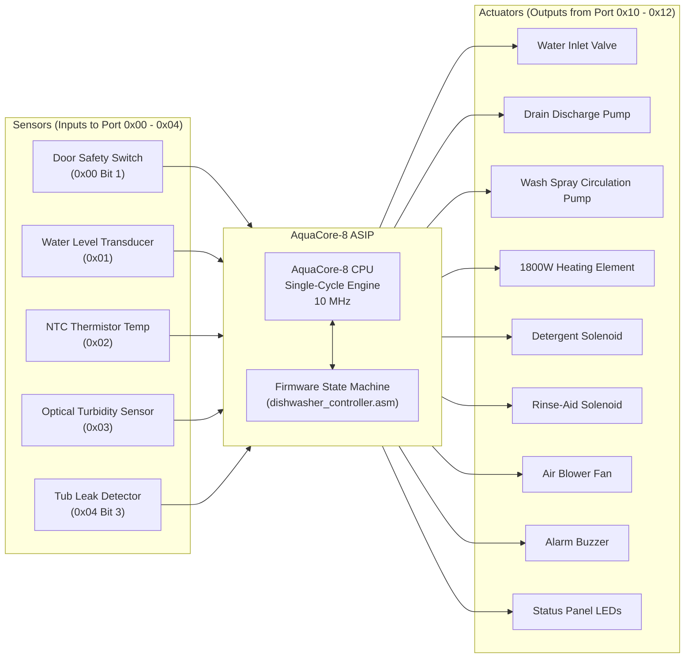
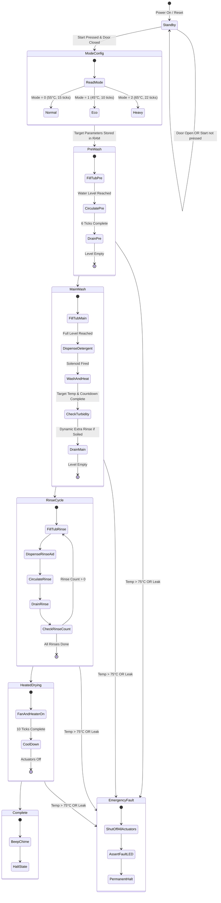

# AquaCore-8: Micro-Architecture & System Diagrams

---

## 1. High-Level Processor Datapath & Control Architecture

```mermaid
flowchart TD
    subgraph FetchStage ["1. Instruction Fetch Unit"]
        PC["Program Counter (PC)<br>8-bit Register"] -->|Address [7:0]| ROM["Instruction ROM<br>256 x 16-bit"]
        PC -->|PC| Inc["+1 Adder"]
        Inc -->|PC + 1| PCMux["Next PC Mux"]
        PCMux -->|New PC| PC
    end

    subgraph ControlStage ["2. Instruction Decode & Control"]
        ROM -->|Opcode [15:12]| CU["Hardwired Control Unit"]
        ROM -->|Funct [5:3]| CU
        ROM -->|Cond [11:8]| CU
        CU -->|RegWrite| RegFile
        CU -->|ALUSrc| ALUMux
        CU -->|ALUOp| ALU
        CU -->|MemRead/Write| RAM
        CU -->|IORead/Write| IO
        CU -->|Branch/Jump| PCMux
    end

    subgraph ExecuteStage ["3. Execution & Register File"]
        ROM -->|Rd [11:10]| RegFile["Register File<br>4 x 8-bit (R0..R3)"]
        ROM -->|Rs [9:8]| RegFile
        ROM -->|Rt [7:6]| RegFile
        RegFile -->|Read Data 1| ALU["8-Bit Arithmetic Logic Unit"]
        RegFile -->|Read Data 2| ALUMux["ALUSrc MUX"]
        ROM -->|Immediate [7:0]| ALUMux
        ALUMux -->|Operand B| ALU
        ALU -->|Result [7:0]| WBMux["Writeback MUX"]
        ALU -->|Flags [Z, C, N, V]| CU
    end

    subgraph SubroutineStack ["4. Subroutine Call Stack"]
        Inc -->|Return Addr (PC+1)| Stack["Hardware Return Stack<br>16 x 8-bit"]
        Stack -->|Pop PC (RET)| PCMux
        ROM -->|Target Addr (CALL)| PCMux
    end

    subgraph MemoryIOStage ["5. Memory & Peripheral I/O"]
        ALU -->|Address [7:0]| RAM["Data Memory (RAM)<br>256 x 8-bit"]
        RegFile -->|Write Data| RAM
        RAM -->|Read Data| WBMux
        ALU -->|Port Address [7:0]| IO["I/O Port Controller<br>32 Peripheral Registers"]
        RegFile -->|Write Data| IO
        IO -->|Read Data| WBMux
        WBMux -->|Writeback Data| RegFile
    end
```

---

## 2. Cyber-Physical Dishwasher Closed-Loop Automation



---

## 3. Dishwasher Cycle Control State Diagram


